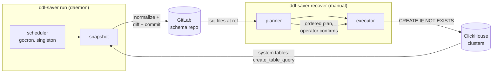

# ddlSaver

Continuous snapshots of ClickHouse DDL into a GitLab repository, and a safe, manual recovery path back.

Every N hours ddlSaver reads `CREATE` statements from your clusters, normalizes them, and commits any changes to a schema repository as plain `.sql` files — one file per object, reviewable like any other code. When an object is lost, `ddl-saver recover` reads those files back, builds a dependency-ordered plan, shows it to you, and applies it with `CREATE ... IF NOT EXISTS` only.

## Design principles

1. **The repo stores pure SQL.** No sidecar metadata, no custom formats. An object's identity (cluster, database, kind, name) is encoded in its file path; its dependencies are extracted from the SQL text at recovery time, read-only. What you see in GitLab is exactly what would be executed.
2. **Recovery is manual, always.** There is no recovery mode in the config and no way to schedule it. A human runs `recover`, reads the plan, and confirms. Snapshot (automatic, write-to-git) and recovery (manual, write-to-ClickHouse) never share a code path that could confuse their directions.
3. **The tool never destroys anything in ClickHouse.** `recovery.create_strategy` is locked to `if_not_exists` — validation rejects any other value. No `DROP`, no `CREATE OR REPLACE`. On the git side, files for objects that disappeared from the cluster are *archived* to a `_deprecated/` area by default; hard deletion (`on_deleted = "prune"`) is opt-in.
4. **Fail loudly, not silently.** A missing `${ENV}` variable, a `--object` pattern matching nothing, an unresolvable dependency in strict mode — all fatal errors, not warnings.

## Architecture



Package layout:

```
cmd/ddl-saver/          CLI: flag parsing + wiring only
internal/app/           orchestration (snapshot loop body, recover flow), runtime status — tested with fakes
internal/model/         shared identity types (ObjectRef, ObjectKind)
internal/config/        TOML + strict ${ENV} interpolation + validation
internal/clickhouse/    client interface, chconn adapter, DDL normalizer, filters
internal/gitlab/        repo interface, differ/batcher, GitLab SDK adapter
internal/state/         per-cluster manifest (checksums, change counts)
internal/snapshot/      snapshot orchestration (list → normalize → diff → commit)
internal/recovery/      dep extraction, repo loader, planner, executor
internal/scheduler/     gocron wrapper (no overlapping runs)
internal/observability/ slog setup, /health endpoints
test/fixtures/          DDL fixtures for the dependency extractor
test/e2e/               real binary vs. real cluster (build tag: e2e)
```

Repository layout produced by snapshots:

```
schemas/<cluster>/<database>/_database.sql
schemas/<cluster>/<database>/<kind>/<object>.sql
schemas/<cluster>/_deprecated/<database>/...
schemas/<cluster>/manifest.json
```

`_database.sql` is the database's own `CREATE DATABASE` (engine, `ON CLUSTER`, Replicated paths). It is written for every database that has at least one snapshotted object, and it is what recovery uses to bring a dropped database back before its tables.

where `<kind>` is one of `tables`, `views`, `materialized_views`, `dictionaries`. The `_deprecated/` area holds the last-known DDL of objects that were dropped from the cluster (see the deletion lifecycle below).

## Quickstart

```bash
# 1. Build
make tidy build        # first run resolves modules; see "Dependencies" below

# 2. Configure
cp examples/config.toml config.toml
export CH_PROD_USER=ddl_reader CH_PROD_PASSWORD=... GITLAB_TOKEN=...
./bin/ddl-saver validate -config config.toml -connect

# 3. One-shot snapshot, then the daemon
./bin/ddl-saver snapshot -config config.toml -dry-run
./bin/ddl-saver snapshot -config config.toml
./bin/ddl-saver run -config config.toml
```

The **snapshot** user needs only read access. This is the exact minimum (checked against ClickHouse 25.8):

```sql
GRANT SHOW ON *.* TO ddl_reader;                    -- system.tables, system.databases, SHOW CREATE DATABASE
GRANT SELECT ON system.macros TO ddl_reader;        -- is there a {cluster} macro
GRANT SELECT ON system.clusters TO ddl_reader;      -- shards and replicas
GRANT SELECT ON system.server_settings TO ddl_reader; -- optional: default_replica_path
```

Mind what "missing grant" looks like: a user that loses `SHOW` gets an empty `system.tables` and **no error**. ddlSaver therefore refuses to act on a cluster that reports zero objects while the repository holds some (see *Empty cluster guard* below).

**Recovery** additionally needs `CREATE DATABASE`, `CREATE TABLE`, `CREATE VIEW`, `CREATE DICTIONARY` on the target databases, `CLUSTER` for `ON CLUSTER`, and whatever the objects themselves read (`SELECT` on a materialized view's source, `INSERT` on its target, `dictGet`). Run recovery under a separate, more privileged account and keep the daemon's account read-only. The GitLab token needs `api` scope with write access to the schema project.

`validate -connect` checks all of it at once — every cluster and the GitLab project, branch and token — and reports every failure in one run.

## Configuration

See `examples/config.toml` — every key is annotated there. Highlights:

| Key | Default | Meaning |
|---|---|---|
| `scheduler.spec` | — | cron for snapshots (daemon mode only) |
| `scheduler.job_timeout` | `30m` | upper bound for one pass over all clusters |
| `app.graceful_timeout` | `30s` | how long shutdown waits for an in-flight snapshot |
| `clusters[].connection.endpoints` | — | tried in order; list order = failover priority |
| `clusters[].connection.secure` | `false` | TLS on the native protocol (port 9440, now the default port) with any auth type |
| `clusters[].auth.ca_file` | system store | root CA that signed the server certificate; needs TLS on |
| `clusters[].filter.include_engines` | all | allow-list; an entry also admits its `Replicated*` variant |
| `gitlab.on_deleted` | `deprecate` | dropped object's file: `keep` in place / `deprecate` (move to `_deprecated/`) / `prune` (delete) |
| `gitlab.commit_batch_size` | `100` | max file actions per commit (GitLab API limit) |
| `recovery.defer_invalid_objects` | — | `true`: defer objects with unresolvable deps (exit 2); `false`: refuse partial plans |
| `recovery.require_confirmation` | — | interactive `[y/N]` before apply (`-yes` skips) |

`${VAR}` anywhere in the file is replaced from the environment at load time; **all** missing variables are reported in one error.

### TLS (port 9440)

```toml
  [clusters.connection]
  secure    = true
  endpoints = [{ host = "ch-1.prod.internal" }]   # port defaults to 9440

  [clusters.auth]
  type     = "password"
  user     = "${CH_PROD_USER}"
  password = "${CH_PROD_PASSWORD}"
  ca_file  = "/etc/ddl-saver/tls/company-root.crt"
```

The server certificate is always verified, including the host name of each endpoint, so connect by the names the certificate was issued for. `ca_file` is optional when the company CA is installed in the system store (in the image: copy it to `/usr/local/share/ca-certificates/` and run `update-ca-certificates`, or set `SSL_CERT_FILE`). The same store is what the GitLab client trusts for an `https://` GitLab behind the company CA — the token authenticates, but the certificate still has to be trusted. `ca_file` without TLS is a validation error rather than a silent plaintext connection.

## Recovery runbook

```bash
# Restore one object (dependencies come along automatically):
ddl-saver recover -config config.toml -cluster prod-analytics \
    -object events.clicks_mv

# From a specific point in history:
ddl-saver recover ... -object events.clicks_mv -ref 4f2a91c

# Table plus the MVs that read from it:
ddl-saver recover ... -object events.clicks_raw -with-dependents

# Globs, multiple targets, plan-only:
ddl-saver recover ... -object 'events.clicks_*' -object refdata.geo -dry-run

# Whole cluster (disaster recovery), non-interactive:
ddl-saver recover -config config.toml -cluster prod-analytics -yes
```

What the planner guarantees before anything executes:

- **Upstream closure** — everything a target needs is either in the plan (ordered before it) or already exists live. A live object satisfies a dependency and stops the walk; it is listed as `skip`.
- **Databases are prerequisites** — if a target's database is gone, the plan creates it first from `_database.sql`. Snapshots that predate database files get a minimal synthesized `CREATE DATABASE` instead, flagged as such in the plan's REASON column so you can object before it runs.
- **Topological order** — MV source tables and `TO` targets before the MV, dictionary source tables before the dictionary, `Distributed` local tables before the distributed wrapper. Cycles abort planning with the cycle members named.
- **Defer over guess** — an object whose dependency exists neither in the repo nor in the cluster is deferred (with `defer_invalid_objects = true`), and everything depending on it is deferred transitively. Strict mode refuses to produce such a plan at all.
- **Notices** — live MVs reading from a table you are about to recreate are called out, as are external dependencies (`remote(...)`, HTTP dictionary sources) that cannot be verified.

Exit codes: `0` fully applied, `2` partial (something deferred/failed — the report names each object and root cause), `1` fatal — including a mistake on the command line, which is rejected before the config is even read. Every option is a `-flag`: a stray word such as `recover -cluster prod events.clicks` is an error, not a silently ignored argument.

During execution each object's existence is re-checked immediately before its `CREATE` (plans age while you read them), transient errors are retried with linear backoff, and a failure defers its transitive dependents rather than producing a wall of guaranteed-to-fail errors.

**Run recovery and an active snapshot schedule against the same cluster with care**: recovery only ever creates objects, so the worst interaction is a snapshot commit racing your session — but reading a plan while the repo moves under you is confusing. Prefer pinning `-ref`.

## Topologies and engines

### Single node (one shard, one replica)

Supported with no configuration. Topology is detected per cluster at every run:

| What the server reports | `IsDistributed` | `ON CLUSTER` added? |
|---|---|---|
| no `cluster` macro in `system.macros` | false | no |
| `cluster` macro, 1 shard × 1 replica | false | no |
| `cluster` macro, >1 shard or >1 replica | true | yes, as `ON CLUSTER '{cluster}'` |

So a single node is snapshotted and restored as plain `CREATE TABLE db.t (...)`, and the same holds for the `_database.sql` files and for any `CREATE DATABASE` the planner has to synthesize. DDL that *already* carries an explicit `ON CLUSTER` is never rewritten — operator intent is preserved on any topology.

A single node may still use `ReplicatedMergeTree` (common when replicas are planned later, or with a `Replicated` database engine); that is orthogonal to `ON CLUSTER` and works.

The one case to know about is **restoring across topologies**: a snapshot taken from a distributed cluster contains `ON CLUSTER '{cluster}'`, and replaying it on a node that doesn't define the `cluster` macro fails. Recovery recognizes this and says so instead of surfacing a raw server error:

```
failed   events.clicks: permanent failure (ClickHouse code 36): No macro 'cluster' in config
         hint: this server does not define the "cluster" macro used by the snapshotted DDL.
               That usually means DDL captured from a distributed cluster is being restored to
               a single node (or a differently macro'd one): define the macro in the server
               config, or restore from a snapshot of this cluster
```

### ReplicatedMergeTree and the ZooKeeper path

Yes — the ZooKeeper path is part of the DDL and is stored verbatim, macros and all:

```sql
CREATE TABLE events.clicks (`ts` DateTime)
ENGINE = ReplicatedMergeTree('/clickhouse/tables/{shard}/events/clicks', '{replica}')
ORDER BY ts
```

`{shard}`, `{replica}` and `{uuid}` are kept as literal text, never expanded — that is what makes one file valid on every replica. The path is passed through untouched by normalization, by the `IF NOT EXISTS` injection, and by the dependency extractor (a ZooKeeper path is not a table reference and never becomes a dependency edge). Tests pin all three.

Both argument forms are handled, and they differ in what can go wrong:

| DDL | Path comes from | Restore hazard |
|---|---|---|
| `ReplicatedMergeTree('/path/{shard}/...', '{replica}')` | the DDL itself | pinned path — a stale registration blocks CREATE; shared ZooKeeper across clusters silently joins the original replica set |
| `ReplicatedMergeTree` (no arguments) | the server's `default_replica_path` / `default_replica_name` | portable only to servers that define them; safe against stale paths **if** the default is UUID-based |

ddlSaver reads `default_replica_path` and `default_replica_name` from `system.server_settings` when connecting (best-effort: the table needs ClickHouse 22.10+ and read access, and failing to read it is never fatal). The plan then says which case applies:

```
### explicit path
  ! 1 object(s) pin an explicit ZooKeeper path (events.clicks): those paths must be free.
    If these were dropped without SYNC, the stale registration makes CREATE fail with
    "Replica ... already exists"

### argument-less, UUID-based server default
  ! 1 object(s) omit the ZooKeeper path (events.clicks) and take the server default
    "/clickhouse/tables/{uuid}/{shard}", which is UUID-based: each recreated table gets a
    fresh path, so no stale-path conflict — but it is a new replica set and starts empty
    rather than reattaching to existing data

### argument-less, non-UUID server default
  ! ... which is not UUID-based: the resolved path is deterministic, so a stale
    registration from a previous incarnation will block CREATE

### argument-less, defaults unreadable
  ! ... rely on the server's default_replica_path, which could not be read from this
    cluster (needs ClickHouse 22.10+ and access to system.server_settings). If the target
    does not define it, these CREATEs fail
```

The UUID-based default is the friendliest shape for disaster recovery: a recreated table can never collide with a stale registration and can never be adopted into another cluster's replica set. The trade-off is that it never reattaches to existing data either.

What this means operationally:

- **Restoring onto a cluster whose ZooKeeper node is free** works and is the normal case.
- **Restoring a table whose ZooKeeper path is still registered fails**, with `Replica ... already exists` (code 253). This happens when the table was dropped without `SYNC`, or a sibling replica still holds the path. Recovery treats this as permanent — it does not burn retries — and prints how to release the path. The plan also warns *before* you confirm:

  ```
  Notices:
    ! 3 object(s) use a Replicated* engine (events.clicks, events.orders, events.sessions):
      their ZooKeeper paths must be free. If these were dropped without SYNC, the stale path
      makes CREATE fail with "Replica ... already exists"
  ```

- **Paths built on `{uuid}`** (the `default_replica_path` shape on modern servers) get a fresh UUID on recreation, so they never collide — but the restored table is a new replica set, not a reattachment to the old data.
- **Restoring to a different cluster that shares a ZooKeeper ensemble is dangerous**: identical paths mean the new tables join the *old* table's replica set and begin replicating its data. Change the paths (or the `{shard}` macro, or the ensemble) before a cross-cluster restore. ddlSaver cannot detect this for you.

Being explicit about the boundary: ddlSaver restores the *schema*. Recreating a replicated table gives you an empty table bound to a replica path; if another live replica holds the data, ClickHouse replicates it back, and if none does, the table is empty. That is schema recovery, not data recovery.

## Safety model

The stated goal is that ddlSaver cannot damage a production database. Here is precisely what enforces that, and where the remaining risk sits.

### The snapshot path cannot write at all

`snapshot.Source` — the only ClickHouse interface the scheduled daemon consumes — exposes exactly two methods, `Topology` and `ListObjects`. There is no `Exec` on it. The daemon physically cannot execute a statement, and a regression test (`TestSourceCannotWrite`) fails if anyone widens that interface. Every query the snapshot path sends is a `SELECT` against `system.tables`, `system.macros` and `system.clusters`.

Give the daemon a read-only ClickHouse user. It needs nothing more.

### The recovery path executes only guarded statements

Recovery is the one code path that writes, and every statement passes `GuardDDL` before reaching the driver. A statement is rejected unless **all** of these hold:

| Rule | Blocks |
|---|---|
| Single statement per file | `CREATE TABLE ...; DROP TABLE other` chained payloads |
| Verb is `CREATE` or `ATTACH` | `DROP`, `ALTER`, `TRUNCATE`, `RENAME`, `DETACH`, `INSERT`, `SYSTEM`, `SELECT`, … |
| No `OR REPLACE` | destructive overwrite of a live object |
| No `TEMPORARY` | non-recoverable state |
| Statement name == file path | `tables/orders.sql` containing `CREATE TABLE events.customers` |
| Statement kind == directory | a plain table smuggled into `materialized_views/` |
| `IF NOT EXISTS` present | injected if the snapshot lacked it (ClickHouse's `create_table_query` does not include it) |

The guard runs **twice**: once at plan time, so a bad file stops the run *before* you are asked to confirm, and once in the executor immediately before each call, so no plan — however stale or however constructed — can carry unvalidated SQL to a cluster. A safety violation in the executor always aborts the remaining work, regardless of `defer_invalid_objects`.

If any file fails, planning refuses **entirely** rather than applying "the safe subset": a schema repo containing a `DROP` means something is wrong (tampering, a bad merge, hand-editing), and that deserves a human, not a partial apply.

### Why `IF NOT EXISTS` matters more than the existence check

ddlSaver checks whether an object exists before creating it, but that check is inherently racy — the plan is built, an operator reads it, minutes pass. `IF NOT EXISTS` is what makes the operation genuinely idempotent at the server. The existence check is an optimization and a UX nicety; the SQL keyword is the actual guarantee.

### Defaults are the safe direction

- `recovery.require_confirmation` defaults to **true**, and — importantly — *omitting the key* leaves it true. Only an explicit `require_confirmation = false` disables the prompt. (Implemented with a pointer field precisely so an absent key cannot silently mean "no.")
- `gitlab.on_deleted` defaults to `deprecate`: files are archived, never destroyed, unless you opt into `prune`.
- `recovery.create_strategy` is locked to `if_not_exists`; validation rejects any other value.
- Unmanaged files in the schema repo are never deleted by any policy.

### Recommended production posture

1. **Two ClickHouse users.** The daemon runs as a read-only user; the `CREATE` grant lives only in the credentials a human uses for `recover`. This makes "the daemon breaks prod" impossible at the database level, not just the code level.
2. **Protect the schema repo branch.** The repo is a trust boundary — recovery executes what is in it. Require MR approval on `schemas/`.
3. **Rehearse recovery somewhere else first.** `-cluster staging` against a restored copy, then `-dry-run` on prod, then the real run.
4. **Always `-dry-run` first on prod**, and pin `-ref` so the plan cannot shift under you.

### What this does *not* protect against

Being straight about the boundaries:

- **A valid `CREATE` can still be wrong.** If a snapshotted MV had a bug, recovery faithfully restores the bug. ddlSaver guarantees the *shape* of the statement, not the correctness of your schema.
- **Recreating an MV does not replay history.** A restored materialized view starts processing from the moment it exists; it does not backfill. Data reconciliation is your job, not the tool's.
- **No `data` protection is implied.** ddlSaver only ever touches DDL. It cannot delete rows — but it also cannot restore them. It is not a backup product; pair it with a real data backup.
- **`ON CLUSTER` fan-out is trusted.** A restored statement carrying `ON CLUSTER '{cluster}'` executes on every node the macro resolves to. Verify the macro means what you think on the target cluster.
- **GitLab itself was not part of the test bench.** The adapter is tested over real HTTP against an in-process server implementing the documented REST API, and compiled against the SDK's predecessor (`xanzy/go-gitlab` v0.115, same API); it has not talked to an actual GitLab instance. `validate -connect` is the first thing to run against yours.

## Dependencies

| Module | Role | Note |
|---|---|---|
| `github.com/vahid-sohrabloo/chconn/v3` | ClickHouse native protocol | Pinned to **v3.0.3**, the last release that builds with Go 1.26 (v3.0.4 and later require Go 1.27). End-to-end tested against ClickHouse 25.8. |
| `gitlab.com/gitlab-org/api/client-go` | GitLab API | This is the maintained home of the former `xanzy/go-gitlab` (archived 2025); the API is identical. |
| `github.com/go-co-op/gocron/v2` | cron scheduling | Singleton mode prevents overlapping snapshot runs. |
| `github.com/pelletier/go-toml/v2` | config parsing | |

Run `go mod tidy` after cloning — `go.sum` is not shipped (it could not be generated completely where this was built), and the `client-go` version in `go.mod` is a starting point: `go get gitlab.com/gitlab-org/api/client-go@latest` picks the current one.

## Testing

```bash
make test               # unit, -race -shuffle=on: every package incl. the app flows
make cover              # statement coverage
make fuzz               # 30s per target on the three text parsers
make test-e2e           # the real binary against a real two-replica cluster (see test/e2e/README.md)
```

The unit suite covers the full snapshot→recover cycle against in-memory fakes, including the CLI flows (dry-run, declined confirmation, headless without `-yes`, tampered repo, partial apply, command-line mistakes). The GitLab adapter is tested over real HTTP against an in-process server that speaks the REST API (`internal/gitlab/gitlabtest`): pagination, URL escaping, the different meanings of 404, parallel downloads, commit payloads. Config loading runs through the real TOML parser, including secrets with quotes and backslashes. Three fuzz targets guard the parsers that take arbitrary text.

`test/e2e` runs the built binary against a real ClickHouse cluster — one shard, two replicas, Keeper, TLS on the secure native port, password auth, a private root CA: validate, snapshot, no-op snapshot, `ALTER`, recovery of dropped objects with replication verified afterwards, a table lost on one replica, a stale ZooKeeper path (code 253) and its remedy, a dropped database and the empty-cluster guard, full recovery, and the daemon with its health endpoints and `SIGTERM`. It last passed on ClickHouse 25.8 LTS with chconn v3.0.3.

## Operations notes

- **Empty cluster guard**: if ClickHouse reports no objects at all while the repository holds object files for that cluster, the snapshot fails with `cluster returned no objects` and changes nothing; `/health/ready` goes red. The usual causes are a lost `SHOW` grant or an endpoint that now points at a blank server. If the cluster really is empty, run `ddl-saver snapshot -cluster <name> -allow-empty` once by hand — the daemon never does this on its own.
- **Implicit tables**: the hidden storage of a materialized view created without `TO` (`.inner.<mv>` / `.inner_id.<uuid>`) is never snapshotted; ClickHouse recreates it with the view.
- **Replicated databases**: objects inside a database with `ENGINE = Replicated` are stored without `ON CLUSTER` (the server rejects it there); the database itself keeps it.
- **Names**: a database or table name containing `/`, `\`, `%`, a control character, or equal to `.`/`..`/`_deprecated` is percent-encoded in its file name (`2024/q1` → `2024%2Fq1.sql`). Ordinary names are untouched.
- **Existence is per node**: recovery asks the node it connected to (the first reachable entry in `connection.endpoints`) what exists, and the plan says which node that was. A table missing on *another* replica shows as existing. To restore it there, list that replica first and run recovery again: `CREATE ... ON CLUSTER IF NOT EXISTS` is a no-op where the table exists, and the missing replica rejoins the same ZooKeeper path and fetches its data.
- **Health**: on `app.health_addr` — `GET /health/live` (process up), `GET /health/ready` (no cluster's last snapshot failed; answered from memory, never by opening connections), `GET /status` (JSON: per-cluster last run, last success, last error, last stats).
- **Performance**: every run reads the cluster's files back from GitLab, one request per file, eight in parallel. For repositories beyond several thousand objects, switching `GetFiles` to the repository-archive endpoint is the known optimization point (the interface already isolates it).
- **Deletion lifecycle**: with the default `on_deleted = "deprecate"`, a dropped table's file (or every file of a dropped database) moves to `schemas/<cluster>/_deprecated/<db>/<kind>/` in the same commit, and `manifest.json` records `since` when it went missing. If the object is later recreated in ClickHouse, the archived copy is removed automatically. Recovery ignores `_deprecated/` on the current ref — to restore a dropped object, point `-ref` at a commit where it was still live (or move the file back manually and re-run). Switching policies does not retroactively clean the archive.
- **Manifest churn**: `manifest.json` contains a timestamp but is only committed when the object set (or deprecation records) actually changed, so idle clusters produce zero commits.
- **Commit messages**: `ddlSaver: snapshot <cluster> (+a ~m -d, deprecated k, undeprecated r)` counts the live `.sql` files touched by that commit, with archive movements called out separately.

## Troubleshooting

| Symptom | Likely cause |
|---|---|
| `Replica ... already exists` (code 253) | the ZooKeeper path is still registered; wait out the delayed drop (8 minutes by default) or run the `SYSTEM DROP REPLICA ... FROM ZKPATH ...` statement the report prints, with the real path and replica filled in |
| `No macro 'cluster' in config` | DDL from a distributed cluster is being restored to a node without that macro (see Topologies and engines) |
| `undefined environment variables: ...` at start | export the listed vars; all are reported at once |
| `pattern "db.x_*" matches no object` | the object was never snapshotted (check filters) or wrong `-ref` |
| Objects deferred with `missing dependency` | the dependency is outside the snapshot (filtered out, another cluster, or a table function); restore it first or re-check filters |
| `dependency cycle detected among: ...` | genuinely circular view definitions; fix in ClickHouse, re-snapshot |
| Snapshot commits every run with no schema changes | clocks/`GeneratedAt` are excluded by design — check for nondeterministic DDL (e.g. comments with timestamps) |
| A dropped object's file vanished from `<db>/<kind>/` | look in `schemas/<cluster>/_deprecated/` — the default `on_deleted = "deprecate"` moved it there; the manifest says since when |
| `all endpoints failed` | first reachable endpoint wins; the error lists the reason per endpoint |
