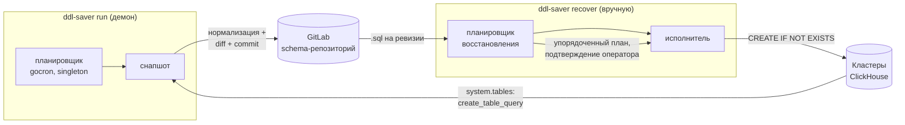

# ddlSaver

Регулярные снапшоты DDL ClickHouse в репозиторий GitLab и безопасное ручное восстановление обратно.

Каждые N часов ddlSaver читает `CREATE`-выражения из ваших кластеров, нормализует их и коммитит изменения в schema-репозиторий обычными `.sql`-файлами — один файл на объект, с ревью как у любого кода. Когда объект потерян, `ddl-saver recover` читает эти файлы, строит план в порядке зависимостей, показывает его оператору и применяет строго через `CREATE ... IF NOT EXISTS`.

## Принципы

1. **Репозиторий хранит чистый SQL.** Никаких sidecar-метаданных и собственных форматов. Идентичность объекта (кластер, база, тип, имя) закодирована в пути файла; зависимости извлекаются из текста SQL в момент восстановления, только на чтение. То, что видно в GitLab — ровно то, что будет исполнено.
2. **Восстановление всегда ручное.** В конфиге нет режима восстановления, и его нельзя поставить в расписание. Человек запускает `recover`, читает план и подтверждает. Снапшот (автоматика, запись в git) и восстановление (вручную, запись в ClickHouse) не разделяют код, где можно перепутать направление.
3. **Инструмент ничего не разрушает в ClickHouse.** `recovery.create_strategy` зафиксирована как `if_not_exists` — валидация отклонит любое другое значение. Ни `DROP`, ни `CREATE OR REPLACE`. На стороне git файлы объектов, исчезнувших из кластера, по умолчанию *архивируются* в каталог `_deprecated/`; жёсткое удаление (`on_deleted = "prune"`) включается явно.
4. **Падать громко, а не молчать.** Отсутствующая переменная `${ENV}`, шаблон `--object` без совпадений, неразрешимая зависимость в строгом режиме — фатальные ошибки, а не предупреждения.

## Архитектура



Структура пакетов:

```
cmd/ddl-saver/          CLI: только разбор флагов и сборка зависимостей
internal/app/           оркестрация (тело цикла снапшота, поток recover), runtime-статус — тестируется на фейках
internal/model/         общие типы идентичности (ObjectRef, ObjectKind)
internal/config/        TOML + строгая интерполяция ${ENV} + валидация
internal/clickhouse/    интерфейс клиента, адаптер chconn, нормализатор DDL, фильтры
internal/gitlab/        интерфейс репозитория, differ/батчер, адаптер GitLab SDK
internal/state/         манифест кластера (контрольные суммы, счётчики изменений)
internal/snapshot/      оркестрация снапшота (list → normalize → diff → commit)
internal/recovery/      извлечение зависимостей, загрузчик репо, планировщик, исполнитель
internal/scheduler/     обёртка gocron (без перекрывающихся запусков)
internal/observability/ настройка slog, /health-эндпоинты
test/fixtures/          DDL-фикстуры для извлечения зависимостей
test/e2e/               настоящий бинарник на настоящем кластере (build tag: e2e)
```

Структура schema-репозитория:

```
schemas/<кластер>/<база>/_database.sql
schemas/<кластер>/<база>/<тип>/<объект>.sql
schemas/<кластер>/_deprecated/<база>/...
schemas/<кластер>/manifest.json
```

`_database.sql` — собственный `CREATE DATABASE` базы (engine, `ON CLUSTER`, пути Replicated). Пишется для каждой базы, в которой есть хотя бы один снятый объект, и именно из него восстановление поднимает удалённую базу раньше её таблиц.

где `<тип>` — `tables`, `views`, `materialized_views` или `dictionaries`. Каталог `_deprecated/` хранит последний известный DDL объектов, удалённых из кластера (см. жизненный цикл удаления ниже).

## Быстрый старт

```bash
# 1. Сборка
make tidy build        # первый запуск разрешит модули; см. «Зависимости»

# 2. Конфигурация
cp examples/config.toml config.toml
export CH_PROD_USER=ddl_reader CH_PROD_PASSWORD=... GITLAB_TOKEN=...
./bin/ddl-saver validate -config config.toml -connect

# 3. Разовый снапшот, затем демон
./bin/ddl-saver snapshot -config config.toml -dry-run
./bin/ddl-saver snapshot -config config.toml
./bin/ddl-saver run -config config.toml
```

Пользователю **снапшота** нужно только чтение. Точный минимум (проверено на ClickHouse 25.8):

```sql
GRANT SHOW ON *.* TO ddl_reader;                    -- system.tables, system.databases, SHOW CREATE DATABASE
GRANT SELECT ON system.macros TO ddl_reader;        -- есть ли макрос {cluster}
GRANT SELECT ON system.clusters TO ddl_reader;      -- шарды и реплики
GRANT SELECT ON system.server_settings TO ddl_reader; -- необязательно: default_replica_path
```

Важно, как выглядит «пропавший грант»: пользователь без `SHOW` получает пустую `system.tables` и **никакой ошибки**. Поэтому ddlSaver отказывается действовать, если кластер сообщил ноль объектов, а в репозитории они есть (см. «Защита от пустого кластера» ниже).

Для **восстановления** дополнительно нужны `CREATE DATABASE`, `CREATE TABLE`, `CREATE VIEW`, `CREATE DICTIONARY` на целевые базы, `CLUSTER` для `ON CLUSTER` и то, что читают сами объекты (`SELECT` на источник materialized view, `INSERT` в его цель, `dictGet`). Запускайте восстановление под отдельной, более привилегированной учётной записью, а учётку демона оставьте только на чтение. Токену GitLab нужен scope `api` с правом записи в проект схем.

`validate -connect` проверяет всё сразу — каждый кластер и проект, ветку и токен GitLab — и за один запуск показывает все ошибки.

## Конфигурация

См. `examples/config.toml` — там прокомментирован каждый ключ. Главное:

| Ключ | По умолчанию | Смысл |
|---|---|---|
| `scheduler.spec` | — | cron снапшотов (только режим демона) |
| `scheduler.job_timeout` | `30m` | верхняя граница одного прохода по всем кластерам |
| `app.graceful_timeout` | `30s` | сколько shutdown ждёт незавершённый снапшот |
| `clusters[].connection.endpoints` | — | перебираются по порядку; порядок в списке = приоритет failover |
| `clusters[].connection.secure` | `false` | TLS для native-протокола (порт 9440, он же становится портом по умолчанию) при любом типе auth |
| `clusters[].auth.ca_file` | системное хранилище | корневой CA, которым подписан сертификат сервера; нужен включённый TLS |
| `clusters[].filter.include_engines` | все | allow-list; запись также допускает свой `Replicated*`-вариант |
| `gitlab.on_deleted` | `deprecate` | файл удалённого объекта: `keep` — оставить / `deprecate` — перенести в `_deprecated/` / `prune` — удалить |
| `gitlab.commit_batch_size` | `100` | максимум файловых действий в одном коммите (лимит API GitLab) |
| `recovery.defer_invalid_objects` | — | `true`: откладывать объекты с неразрешимыми зависимостями (код выхода 2); `false`: отказываться от частичных планов |
| `recovery.require_confirmation` | — | интерактивное `[y/N]` перед применением (`-yes` пропускает) |

`${VAR}` в любом месте файла подставляется из окружения при загрузке; **все** отсутствующие переменные перечисляются в одной ошибке.

### TLS (порт 9440)

```toml
  [clusters.connection]
  secure    = true
  endpoints = [{ host = "ch-1.prod.internal" }]   # порт по умолчанию — 9440

  [clusters.auth]
  type     = "password"
  user     = "${CH_PROD_USER}"
  password = "${CH_PROD_PASSWORD}"
  ca_file  = "/etc/ddl-saver/tls/company-root.crt"
```

Сертификат сервера проверяется всегда, включая имя хоста каждого endpoint, поэтому подключайтесь по тем именам, на которые выписан сертификат. `ca_file` не нужен, если корневой сертификат компании установлен в системное хранилище (в образе: положить в `/usr/local/share/ca-certificates/` и выполнить `update-ca-certificates`, либо задать `SSL_CERT_FILE`). Этому же хранилищу доверяет клиент GitLab, если GitLab работает по `https://` с сертификатом компании: токен отвечает за авторизацию, но сертификату всё равно нужно доверять. `ca_file` без включённого TLS — ошибка валидации, а не молчаливое подключение без шифрования.

## Runbook восстановления

```bash
# Восстановить один объект (зависимости подтянутся автоматически):
ddl-saver recover -config config.toml -cluster prod-analytics \
    -object events.clicks_mv

# С конкретной точки истории:
ddl-saver recover ... -object events.clicks_mv -ref 4f2a91c

# Таблицу вместе с MV, которые из неё читают:
ddl-saver recover ... -object events.clicks_raw -with-dependents

# Глобы, несколько целей, только план:
ddl-saver recover ... -object 'events.clicks_*' -object refdata.geo -dry-run

# Весь кластер (disaster recovery), без интерактива:
ddl-saver recover -config config.toml -cluster prod-analytics -yes
```

Что гарантирует планировщик до исполнения чего-либо:

- **Замыкание вверх** — всё, что нужно цели, либо в плане (раньше неё), либо уже существует в кластере. Живой объект закрывает зависимость и останавливает обход; в плане он показан как `skip`.
- **Базы — предпосылки** — если база цели удалена, план сначала создаёт её из `_database.sql`. Для снапшотов, снятых до появления файлов баз, синтезируется минимальный `CREATE DATABASE`, и это явно отмечено в колонке REASON плана — можно возразить до выполнения.
- **Топологический порядок** — таблицы-источники и `TO`-цели раньше MV, таблицы-источники словарей раньше словаря, локальные таблицы раньше `Distributed`-обёртки. Цикл прерывает планирование с перечислением участников.
- **Отложить, а не угадать** — объект, чья зависимость отсутствует и в репозитории, и в кластере, откладывается (при `defer_invalid_objects = true`), и всё, что зависит от него, откладывается транзитивно. Строгий режим вообще откажется строить такой план.
- **Notices** — живые MV, читающие из пересоздаваемой таблицы, будут отмечены; как и внешние зависимости (`remote(...)`, HTTP-источники словарей), которые нельзя проверить.

Коды выхода: `0` — применено полностью, `2` — частично (что-то отложено/упало — отчёт называет каждый объект и первопричину), `1` — фатальная ошибка, в том числе ошибка в командной строке: она отвергается ещё до чтения конфига. Каждая опция — это `-флаг`: лишнее слово, например `recover -cluster prod events.clicks`, — ошибка, а не молча проигнорированный аргумент.

Во время исполнения существование каждого объекта перепроверяется непосредственно перед его `CREATE` (план успевает устареть, пока его читают), временные ошибки ретраятся с линейным backoff, а падение откладывает транзитивных потомков вместо стены заведомо провальных ошибок.

**Восстановление при активном расписании снапшотов на том же кластере — с осторожностью**: восстановление только создаёт объекты, так что худшее — коммит снапшота параллельно вашей сессии; но читать план, пока репозиторий движется, неудобно. Лучше зафиксировать `-ref`.

## Топологии и движки

### Одна нода (один шард, одна реплика)

Поддерживается без какой-либо настройки. Топология определяется по каждому кластеру при каждом запуске:

| Что сообщает сервер | `IsDistributed` | Добавляется `ON CLUSTER`? |
|---|---|---|
| нет макроса `cluster` в `system.macros` | false | нет |
| макрос `cluster`, 1 шард × 1 реплика | false | нет |
| макрос `cluster`, >1 шарда или >1 реплики | true | да, как `ON CLUSTER '{cluster}'` |

То есть одиночная нода снимается и восстанавливается как обычный `CREATE TABLE db.t (...)`; то же касается файлов `_database.sql` и любого `CREATE DATABASE`, который планировщик синтезирует сам. DDL, где `ON CLUSTER` *уже* указан явно, никогда не переписывается — намерение оператора сохраняется на любой топологии.

Одиночная нода при этом может использовать `ReplicatedMergeTree` (обычное дело, когда реплики планируются позже, или при движке базы `Replicated`); это ортогонально `ON CLUSTER` и работает.

Единственный случай, о котором стоит знать, — **восстановление между топологиями**: снапшот с распределённого кластера содержит `ON CLUSTER '{cluster}'`, и его проигрывание на ноде без макроса `cluster` упадёт. Восстановление распознаёт это и объясняет, вместо того чтобы показать сырую ошибку сервера:

```
failed   events.clicks: permanent failure (ClickHouse code 36): No macro 'cluster' in config
         hint: this server does not define the "cluster" macro used by the snapshotted DDL...
```

### ReplicatedMergeTree и путь в ZooKeeper

Да — путь в ZooKeeper является частью DDL и сохраняется дословно, вместе с макросами:

```sql
CREATE TABLE events.clicks (`ts` DateTime)
ENGINE = ReplicatedMergeTree('/clickhouse/tables/{shard}/events/clicks', '{replica}')
ORDER BY ts
```

`{shard}`, `{replica}` и `{uuid}` остаются текстом и никогда не раскрываются — именно это делает один файл пригодным для любой реплики. Путь проходит нетронутым через нормализацию, через вставку `IF NOT EXISTS` и через извлечение зависимостей (путь в ZooKeeper — не ссылка на таблицу и никогда не становится ребром графа). Все три случая закреплены тестами.

Обе формы записи поддерживаются, и риски у них разные:

| DDL | Откуда берётся путь | Риск при восстановлении |
|---|---|---|
| `ReplicatedMergeTree('/path/{shard}/...', '{replica}')` | из самого DDL | путь зафиксирован — устаревшая регистрация блокирует CREATE; общий ZooKeeper между кластерами молча включает таблицу в исходный набор реплик |
| `ReplicatedMergeTree` (без аргументов) | из серверных `default_replica_path` / `default_replica_name` | переносимо только на серверы, где они заданы; устойчиво к устаревшим путям, **если** дефолт основан на `{uuid}` |

ddlSaver читает `default_replica_path` и `default_replica_name` из `system.server_settings` при подключении (best-effort: таблица требует ClickHouse 22.10+ и прав на чтение, а неудача чтения никогда не фатальна). План затем сообщает, какой случай применим:

```
### явный путь
  ! 1 object(s) pin an explicit ZooKeeper path (events.clicks): those paths must be free...

### без аргументов, дефолт на {uuid}
  ! 1 object(s) omit the ZooKeeper path (events.clicks) and take the server default
    "/clickhouse/tables/{uuid}/{shard}", which is UUID-based: each recreated table gets a
    fresh path, so no stale-path conflict — but it is a new replica set and starts empty...

### без аргументов, дефолт без {uuid}
  ! ... which is not UUID-based: the resolved path is deterministic, so a stale
    registration from a previous incarnation will block CREATE

### без аргументов, дефолты прочитать не удалось
  ! ... rely on the server's default_replica_path, which could not be read from this
    cluster (needs ClickHouse 22.10+ and access to system.server_settings)...
```

Дефолт на основе `{uuid}` — самая удобная форма для disaster recovery: пересозданная таблица не может столкнуться с устаревшей регистрацией и не может быть принята в набор реплик чужого кластера. Плата за это — она и не переподключится к существующим данным.

Что это значит на практике:

- **Восстановление на кластер со свободным узлом в ZooKeeper** работает — это нормальный случай.
- **Восстановление таблицы, чей путь в ZooKeeper ещё зарегистрирован, упадёт** с `Replica ... already exists` (код 253). Так бывает, когда таблицу удалили без `SYNC` или путь держит соседняя реплика. Восстановление считает такую ошибку постоянной — не тратит ретраи — и печатает, как освободить путь. План предупреждает об этом *до* подтверждения:

  ```
  Notices:
    ! 3 object(s) use a Replicated* engine (events.clicks, events.orders, events.sessions):
      their ZooKeeper paths must be free...
  ```

- **Пути на основе `{uuid}`** (форма `default_replica_path` на современных серверах) получают новый UUID при пересоздании и не конфликтуют — но восстановленная таблица является новым набором реплик, а не переподключением к старым данным.
- **Восстановление на другой кластер, разделяющий тот же ансамбль ZooKeeper, опасно**: одинаковые пути означают, что новые таблицы войдут в набор реплик *старой* таблицы и начнут реплицировать её данные. Перед восстановлением между кластерами меняйте пути (или макрос `{shard}`, или ансамбль). Сам ddlSaver этого за вас не обнаружит.

Чётко о границе: ddlSaver восстанавливает *схему*. Пересоздание реплицированной таблицы даёт пустую таблицу, привязанную к пути реплики; если данные держит другая живая реплика, ClickHouse дореплицирует их обратно, а если нет — таблица останется пустой. Это восстановление схемы, а не данных.

## Модель безопасности

Заявленная цель — ddlSaver не может повредить продакшн-базу. Ниже точно то, что это обеспечивает, и где остаётся риск.

### Путь снапшота вообще не умеет писать

`snapshot.Source` — единственный интерфейс ClickHouse, который потребляет демон по расписанию — содержит ровно два метода: `Topology` и `ListObjects`. Метода `Exec` в нём нет. Демон физически не может выполнить оператор, а регрессионный тест (`TestSourceCannotWrite`) упадёт, если кто-то расширит интерфейс. Все запросы снапшота — `SELECT` к `system.tables`, `system.macros` и `system.clusters`.

Дайте демону read-only пользователя ClickHouse. Больше ему ничего не нужно.

### Путь восстановления выполняет только проверенные операторы

Восстановление — единственный путь, который пишет, и каждый оператор проходит `GuardDDL` до драйвера. Оператор отклоняется, если не выполнено **всё** перечисленное:

| Правило | Что блокирует |
|---|---|
| Один оператор на файл | цепочки вида `CREATE TABLE ...; DROP TABLE other` |
| Глагол — `CREATE` или `ATTACH` | `DROP`, `ALTER`, `TRUNCATE`, `RENAME`, `DETACH`, `INSERT`, `SYSTEM`, `SELECT`, … |
| Нет `OR REPLACE` | разрушающая перезапись живого объекта |
| Нет `TEMPORARY` | невосстановимое состояние |
| Имя в SQL == путь файла | `tables/orders.sql` с `CREATE TABLE events.customers` внутри |
| Тип в SQL == каталог | обычная таблица, подложенная в `materialized_views/` |
| Присутствует `IF NOT EXISTS` | добавляется, если снапшот его не содержал (`create_table_query` в ClickHouse его не включает) |

Guard срабатывает **дважды**: на этапе планирования — чтобы плохой файл остановил запуск *до* запроса подтверждения, и в исполнителе непосредственно перед каждым вызовом — чтобы никакой план, сколь угодно устаревший или собранный в обход, не донёс непроверенный SQL до кластера. Нарушение безопасности в исполнителе всегда прерывает оставшуюся работу, независимо от `defer_invalid_objects`.

Если хоть один файл не прошёл, планирование отказывается **целиком**, а не применяет «безопасное подмножество»: schema-репозиторий с `DROP` внутри означает, что что-то не так (подмена, кривой мёрдж, ручные правки) — и это требует человека, а не частичного применения.

### Почему `IF NOT EXISTS` важнее проверки существования

ddlSaver проверяет наличие объекта перед созданием, но эта проверка принципиально гонночная — план построен, оператор его читает, проходят минуты. Именно `IF NOT EXISTS` делает операцию по-настоящему идемпотентной на стороне сервера. Проверка существования — это оптимизация и удобство; гарантия — ключевое слово в SQL.

### Умолчания смотрят в безопасную сторону

- `recovery.require_confirmation` по умолчанию **true**, и — что важно — *отсутствие ключа* оставляет его true. Отключает подсказку только явное `require_confirmation = false`. (Реализовано полем-указателем именно для того, чтобы отсутствующий ключ не мог тихо означать «не спрашивать».)
- `gitlab.on_deleted` по умолчанию `deprecate`: файлы архивируются, а не уничтожаются, пока вы явно не выберете `prune`.
- `recovery.create_strategy` зафиксирована как `if_not_exists`; валидация отклоняет другие значения.
- Неуправляемые файлы в репозитории не удаляются ни одной политикой.

### Рекомендуемая эксплуатационная схема

1. **Два пользователя ClickHouse.** Демон работает под read-only пользователем; право `CREATE` есть только в учётных данных, которыми человек запускает `recover`. Тогда «демон сломал прод» невозможно на уровне СУБД, а не только кода.
2. **Защитите ветку schema-репозитория.** Репозиторий — граница доверия: восстановление исполняет то, что в нём лежит. Требуйте апрув MR на `schemas/`.
3. **Отрепетируйте восстановление в стороне.** Сначала `-cluster staging` на восстановленной копии, затем `-dry-run` на проде, затем боевой запуск.
4. **На проде всегда сначала `-dry-run`** и фиксируйте `-ref`, чтобы план не поехал под вами.

### От чего это НЕ защищает

Честно о границах:

- **Валидный `CREATE` может быть неправильным.** Если в снятом MV была ошибка, восстановление добросовестно вернёт ошибку. ddlSaver гарантирует *форму* оператора, а не корректность вашей схемы.
- **Пересоздание MV не переигрывает историю.** Восстановленный materialized view начинает обрабатывать данные с момента появления и не делает backfill. Сверка данных — на вас, не на инструменте.
- **Никакой защиты данных не подразумевается.** ddlSaver трогает только DDL. Он не может удалить строки — но и восстановить их тоже не может. Это не бэкап-продукт; используйте его вместе с настоящим бэкапом данных.
- **Fan-out `ON CLUSTER` принимается на веру.** Восстановленный оператор с `ON CLUSTER '{cluster}'` выполнится на всех узлах, куда раскроется макрос. Проверьте, что макрос на целевом кластере означает то, что вы думаете.
- **Сам GitLab в тестовый стенд не входил.** Адаптер тестируется по настоящему HTTP против встроенного сервера, реализующего документированный REST API, и скомпилирован с предшественником SDK (`xanzy/go-gitlab` v0.115, тот же API); с настоящим GitLab он не разговаривал. Первое, что стоит запустить у себя, — `validate -connect`.

## Зависимости

| Модуль | Роль | Примечание |
|---|---|---|
| `github.com/vahid-sohrabloo/chconn/v3` | native-протокол ClickHouse | Зафиксирована **v3.0.3** — последний релиз, который собирается на Go 1.26 (v3.0.4 и новее требуют Go 1.27). Сквозной тест пройден на ClickHouse 25.8. |
| `gitlab.com/gitlab-org/api/client-go` | API GitLab | Это поддерживаемый дом бывшего `xanzy/go-gitlab` (архивирован в 2025); API идентичен. |
| `github.com/go-co-op/gocron/v2` | cron-планирование | Singleton-режим исключает перекрывающиеся запуски снапшота. |
| `github.com/pelletier/go-toml/v2` | парсинг конфига | |

После клонирования выполните `go mod tidy` — `go.sum` не приложен (там, где это собиралось, его нельзя было сгенерировать полностью), а версия `client-go` в `go.mod` — отправная точка: `go get gitlab.com/gitlab-org/api/client-go@latest` возьмёт актуальную.

## Тестирование

```bash
make test               # юнит-тесты, -race -shuffle=on: все пакеты, включая потоки app
make cover              # покрытие
make fuzz               # по 30 с на каждый из трёх парсеров текста
make test-e2e           # настоящий бинарник на настоящем кластере из двух реплик (см. test/e2e/README.md)
```

Юнит-набор покрывает полный цикл снапшот→восстановление на in-memory фейках, включая CLI-потоки (dry-run, отказ в подтверждении, headless без `-yes`, подменённый репозиторий, частичное применение, ошибки в командной строке). Адаптер GitLab тестируется по настоящему HTTP против встроенного сервера, говорящего на REST API (`internal/gitlab/gitlabtest`): пагинация, экранирование URL, разные смыслы 404, параллельная загрузка, содержимое коммитов. Загрузка конфига идёт через настоящий TOML-парсер, включая секреты с кавычками и обратными слэшами. Три fuzz-цели защищают парсеры произвольного текста.

`test/e2e` запускает собранный бинарник на настоящем кластере ClickHouse — один шард, две реплики, Keeper, TLS на защищённом native-порту, вход по паролю, собственный корневой CA: validate, снапшот, пустой повторный снапшот, `ALTER`, восстановление удалённых объектов с проверкой репликации, таблица, пропавшая на одной реплике, занятый путь в ZooKeeper (код 253) и способ его освободить, удалённая база и защита от пустого кластера, полное восстановление, демон с health-эндпоинтами и `SIGTERM`. Последний раз проходил на ClickHouse 25.8 LTS с chconn v3.0.3.

## Эксплуатация

- **Защита от пустого кластера**: если ClickHouse не вернул ни одного объекта, а в репозитории для этого кластера файлы есть, снапшот падает с `cluster returned no objects` и ничего не меняет; `/health/ready` становится красным. Обычные причины — пропавший грант `SHOW` или endpoint, который теперь ведёт на пустой сервер. Если кластер действительно пуст, один раз вручную выполните `ddl-saver snapshot -cluster <имя> -allow-empty` — демон сам так не делает никогда.
- **Неявные таблицы**: скрытое хранилище materialized view без `TO` (`.inner.<mv>` / `.inner_id.<uuid>`) никогда не снимается; ClickHouse создаёт его вместе с view.
- **Replicated-базы**: объекты внутри базы с `ENGINE = Replicated` сохраняются без `ON CLUSTER` (сервер его там отвергает); сама база сохраняется с ним.
- **Имена**: имя базы или таблицы, содержащее `/`, `\`, `%`, управляющий символ или равное `.`/`..`/`_deprecated`, в имени файла кодируется процентами (`2024/q1` → `2024%2Fq1.sql`). Обычные имена не меняются.
- **Существование проверяется на одной ноде**: восстановление спрашивает, что существует, у той ноды, к которой подключилось (первый доступный адрес в `connection.endpoints`), и план называет эту ноду. Таблица, пропавшая на *другой* реплике, выглядит существующей. Чтобы вернуть её там, поставьте эту реплику первой и запустите восстановление ещё раз: `CREATE ... ON CLUSTER IF NOT EXISTS` ничего не делает там, где таблица есть, а пропавшая реплика подключается к тому же пути в ZooKeeper и скачивает данные.
- **Health**: на `app.health_addr` — `GET /health/live` (процесс жив), `GET /health/ready` (последний снапшот ни одного кластера не упал; отвечает из памяти, без открытия соединений), `GET /status` (JSON: по кластерам — последний запуск, последний успех, последняя ошибка, статистика).
- **Производительность**: каждый запуск читает файлы кластера обратно из GitLab, по запросу на файл, восемь параллельно. Для репозиториев свыше нескольких тысяч объектов известная точка оптимизации — перевести `GetFiles` на endpoint архива репозитория (интерфейс это уже изолирует).
- **Жизненный цикл удаления**: при дефолтном `on_deleted = "deprecate"` файл удалённой таблицы (или все файлы удалённой базы) переносится в `schemas/<кластер>/_deprecated/<база>/<тип>/` тем же коммитом, а `manifest.json` фиксирует `since` — с какого момента объект пропал. Если объект позже пересоздали в ClickHouse, архивная копия убирается автоматически. Восстановление игнорирует `_deprecated/` на текущей ревизии — чтобы восстановить удалённый объект, укажите `-ref` на коммит, где файл ещё был живым (или верните файл вручную и повторите). Смена политики не чистит архив задним числом.
- **Шум манифеста**: `manifest.json` содержит таймстемп, но коммитится только при реальном изменении набора объектов (или записей о депрекации) — простаивающие кластеры дают ноль коммитов.
- **Сообщения коммитов**: `ddlSaver: snapshot <cluster> (+a ~m -d, deprecated k, undeprecated r)` считает живые `.sql`-файлы, затронутые этим коммитом; движения архива показаны отдельно.

## Диагностика

| Симптом | Вероятная причина |
|---|---|
| `Replica ... already exists` (код 253) | путь в ZooKeeper ещё зарегистрирован; освободите его через `SYSTEM DROP REPLICA`/`DROP TABLE ... SYNC` — отчёт печатает подсказку |
| `No macro 'cluster' in config` | DDL с распределённого кластера восстанавливается на ноду без этого макроса (см. «Топологии и движки») |
| `undefined environment variables: ...` на старте | экспортируйте перечисленные переменные; все показываются сразу |
| `pattern "db.x_*" matches no object` | объект не попадал в снапшот (проверьте фильтры) или неверный `-ref` |
| Объекты отложены с `missing dependency` | зависимость вне снапшота (отфильтрована, другой кластер или табличная функция); восстановите её сначала или пересмотрите фильтры |
| `dependency cycle detected among: ...` | действительно циклические определения view; исправьте в ClickHouse, переснимите снапшот |
| Снапшот коммитит каждый запуск без изменений схемы | `GeneratedAt` исключён из сравнения by design — ищите недетерминированный DDL (например, комментарии с таймстемпами) |
| Файл удалённого объекта пропал из `<база>/<тип>/` | загляните в `schemas/<кластер>/_deprecated/` — дефолтный `on_deleted = "deprecate"` перенёс его туда; манифест скажет, с какого момента |
| `all endpoints failed` | побеждает первый доступный endpoint; ошибка перечисляет причину по каждому |
